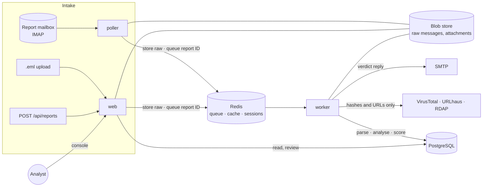
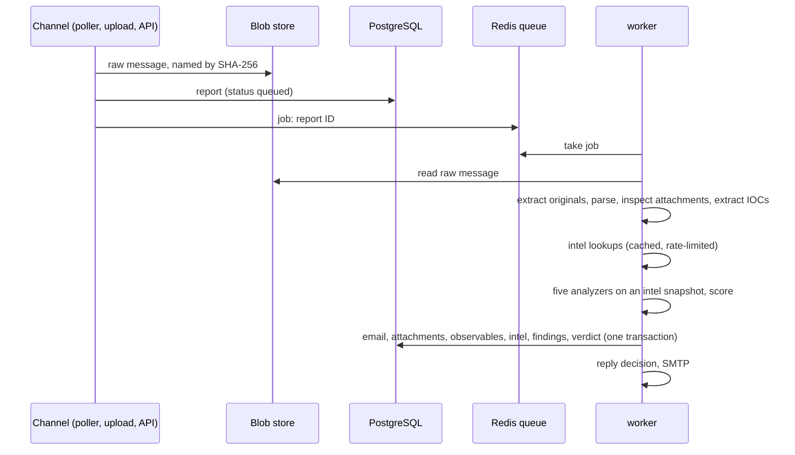

# Architecture

PhishTriage is a single-node application made of three Python processes around
PostgreSQL and Redis. This page explains how a report travels through them, where each
piece of data lives and why the boundaries are where they are. The security reasoning
behind the same boundaries is in [threat-model.md](threat-model.md).

## Processes

| Process | Command | Does | Never does |
| --- | --- | --- | --- |
| `web` | `uvicorn app.main:create_app --factory` | Console, `.eml` upload, REST API, login. Runs `alembic upgrade head` before it starts. | Parse an email. An upload is stored and queued, nothing else. |
| `worker` | `python -m app.worker` | RQ worker: parse, look up, analyse, score, store, reply; the daily retention purge. | Accept connections. |
| `poller` | `python -m app.ingest.imap_poller` | Polls the report mailbox every 30 s, stores and queues new messages, moves them to `Processed`; queues the daily purge. | Parse an email (it reads only the `Message-ID` line). |

All three run from one image (`Dockerfile`: a build stage that installs the locked
dependencies with uv, and a slim runtime stage as user `phishtriage`, UID 10001). In
Compose they run with a read-only root filesystem, no Linux capabilities and
`no-new-privileges`; only the web port and the demo mail ports are published, on
127.0.0.1. GreenMail (the report mailbox) and Mailpit (catches replies) stand in for a
real mail system in development and the demo.

Why this split: the code that touches attacker-controlled email (the parser, the
analyzers, the intel clients) runs only in the worker, which has no listening socket.
The web process, which faces analysts and the network, only reads results. A parser bug
can crash a job, which RQ retries and finally marks failed; it cannot take the console
down.

## Life of a report

1. **Intake** (`app/ingest/submission.py`): every channel calls the same
   `queue_submission`. It checks the size limit, stores the raw bytes in the blob store,
   creates a `reports` row with status `queued` and puts the report ID on the queue. The
   job carries only the ID, serialised as JSON (pickle would turn write access to Redis
   into code execution in the worker). If Redis is down the report is stored as failed
   and `python -m app.cli requeue --failed` retries it later; nothing is lost.
2. **Find the original(s)** (`app/parsing/eml.py`): a report from the mailbox, or a
   submission that carries `message/rfc822` parts, is a wrapper. Each attached email
   becomes a report of its own (children of the first). A wrapper without attachments is
   an inline forward: its body is analysed, its headers (the reporter's) are not.
3. **Parse**: headers, the Received chain, Authentication-Results (RFC 8601), text and
   HTML bodies (HTML is sanitised with `nh3` and stripped of every URL attribute),
   attachments (static inspection: libmagic, ZIP listing, oletools; never extracted, never
   run), indicators (URLs, domains, IPs, addresses, hashes). Limits: 25 MB, 20
   attachments, 10 MIME levels.
4. **Threat intelligence** (`app/intel/`): VirusTotal (hashes, URLs, domains), URLhaus
   (URLs, hosts) and RDAP (domain age) through one HTTP client that only reaches those
   fixed hosts over HTTPS and follows no redirects. Answers are cached in Redis; a token
   bucket shared by all workers holds VirusTotal to 4 requests a minute.
5. **Analyse and score** (`app/analyzers/`, `app/scoring/`): five analyzers (auth,
   sender, URLs, attachments, content), each with a 30 s limit, raise rules with
   evidence. Points come from `rules.yaml`; the total maps to one of four verdicts.
   Details: [scoring.md](scoring.md).
6. **Store**: all results in one transaction. Slow work (parsing, network) happens
   before the first write, so no transaction waits on a provider. The job is idempotent:
   a retry first removes what an earlier attempt stored.
7. **Reply** (`app/notify/reply.py`): for mailbox reports only, under the anti-abuse
   rules in [mailbox.md](mailbox.md). A reply failure is recorded and does not fail the
   job.

A failed job is retried 3 times (10, 30 and 90 s later); after the last attempt the
report is marked failed with the exception type (never its message, which could quote
attacker input).

## Data

| Store | Holds | Lifetime |
| --- | --- | --- |
| PostgreSQL | Reports, parsed emails, attachments (metadata), observables, intel results, findings, users, audit log | Kept; email bodies are cleared by retention |
| Blob store (`/var/lib/phishtriage`, a volume) | Raw submissions and attachment files, named `<kind>/<sha256[:2]>/<sha256>` | `RETENTION_DAYS` (90) |
| Redis | Job queue, intel cache (VirusTotal 24 h, URLhaus 1 h, RDAP 7 d), rate-limit buckets, console sessions, login throttling | TTLs |

The eight tables follow the plan's data model. Columns added on the way, each with its
reason in the PROGRESS decision log:

* `reports`: `parent_id` (one report per attached original), `intake_mode`,
  `submission_*` (the stored raw message), `outer_message_id` (mailbox de-duplication),
  `analyzed_at` (processing time), `error`, `reporter_dmarc`, `reply_status`,
  `replied_at` (replies), `purged_at` (retention).
* `emails`: `to_addrs`, `headers`, `defects`; `intel_results`: `detail`.
* Notes are audit-log entries (`report.note`), not a ninth table.

Paths read back from the database are checked against the blob-name pattern, so a
tampered row cannot point the server at another file. File names from emails are only
ever displayed.

## Periodic work

The poller is the only process with a timer loop, so it is also the clock: after every
poll it queues the retention purge, at most once a day (a Redis key with a one-day
expiry), and the worker runs it. See [retention](#retention) below.

### Retention

`app/retention.py` deletes, for every report older than `RETENTION_DAYS`, the raw
submission, the attachment files and the email bodies, and keeps the verdict, rules,
evidence, headers and indicators. Because blobs are content-addressed and shared, a file
is only deleted when no report inside the period still refers to it. Files go first and
the rows are updated after, so an interrupted run is completed by the next one.
`python -m app.cli purge --dry-run` shows what would go.

## Web layer

FastAPI with Jinja2 templates (autoescaping, `StrictUndefined`), Pico CSS and htmx, all
served from the app itself. The Content-Security-Policy allows scripts, styles and
images only from the app's own origin (no inline script or style anywhere), and the
sanitised HTML body is shown only inside `<iframe sandbox>` from a route with its own
`default-src 'none'; sandbox` policy. Sessions live in Redis; CSRF tokens are an HMAC of
the browser's cookie token. Details: [console.md](console.md).

## Code map

| Path | What |
| --- | --- |
| `app/main.py` | App factory, middleware, routers |
| `app/config.py` | Settings from the environment, policy from `config/settings.yaml` |
| `app/ingest/` | Channels: `submission.py` (shared), `upload.py`, `api.py`, `imap_poller.py` |
| `app/parsing/` | MIME, headers, Received, Authentication-Results, HTML, attachments, IOCs, defanging |
| `app/analyzers/`, `app/scoring/` | The five analyzers, `rules.yaml`, the scoring engine |
| `app/intel/` | Provider clients, allow-listed HTTP client, cache, token bucket |
| `app/pipeline.py`, `app/jobs.py`, `app/queueing.py`, `app/worker.py` | The worker side |
| `app/notify/` | Verdict replies |
| `app/retention.py` | Retention purge |
| `app/web/` | Console: auth, CSRF, security headers, routes, templates, static files |
| `app/export/` | CSV, STIX 2.1, infected ZIP |
| `app/cli.py` | `analyze`, `check-config`, `requeue`, `create-user`, `purge` |
| `scripts/` | Sample generator, `send_sample.py`, `submit_report.py`, `seed_demo.py`, `evaluate.py` |
