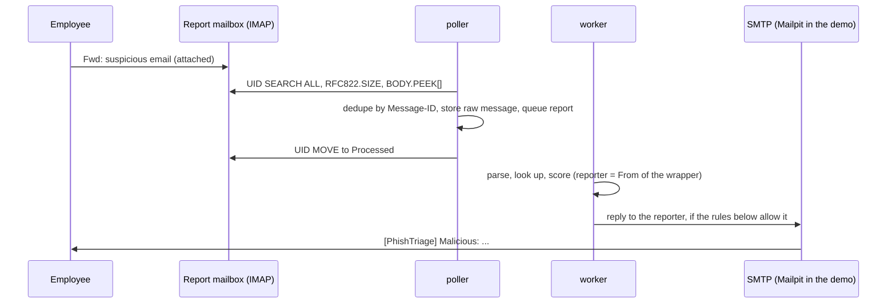

# Report mailbox and replies

Employees report a suspicious email the way they already know: they forward it to the
report mailbox (`report-phishing@example.edu` in the demo), ideally "as an attachment".
The `poller` process picks the report up over IMAP, the worker analyses it like any other
submission, and the reporter gets a plain-text reply with the verdict. This page explains
both halves and the rules that keep the reply from being abused.



## Intake (`app/ingest/imap_poller.py`)

Every `POLL_INTERVAL_SECONDS` (30) the poller logs in and, for at most 50 messages per
round, oldest first:

1. reads the size (`RFC822.SIZE`). A message over 25 MB is moved to the `Rejected`
   folder without being downloaded;
2. downloads it with `BODY.PEEK[]`, so the message is not marked as read;
3. reads only the `Message-ID` header line (the poller never parses email; the worker
   does). If a mailbox report with that Message-ID exists, or without a Message-ID one
   with the same SHA-256, nothing new is created;
4. otherwise stores the raw bytes in the blob store, creates the report and queues it;
5. moves the message to `Processed` (`UID MOVE`, or `COPY` + `\Deleted` + `EXPUNGE` on
   servers without the MOVE extension).

Storing comes before moving. A crash between the two means the message is seen again in
the next round, and the Message-ID check turns that into a no-op. If Redis is down, the
report is stored as failed ("could not be queued"), the message is still moved, and
`python -m app.cli requeue --failed` picks it up later, exactly like the upload and API
channels. A health check file is written after every round that reached the mailbox; the
container is unhealthy when the poller has not reached it for three intervals.

The report wrapper is what the employee sent. Each `message/rfc822` attachment becomes one
report; an inline forward is analysed as one report marked `forwarded_inline` (the headers
are the employee's, so only the links and the text count). The reporter is the `From`
address of the wrapper.

## Replies (`app/notify/reply.py`)

After a mailbox report is scored, the worker decides whether to reply. The decision is
stored in `reports.reply_status` and shown on the report page.

| Check, in this order | `reply_status` when it fails |
| --- | --- |
| The report came from the mailbox and is the first report of its submission (one reply covers every email the employee attached) | nothing recorded |
| No reply was sent yet (re-analysing a report never sends a second one) | unchanged |
| `REPLIES_ENABLED` is true | `not sent: replies are disabled` |
| The reporter's address is in `policy.org_domains` (subdomains included) | `not sent: reporter outside the organisation` |
| Our own mail server vouches for the reporter: the topmost `Authentication-Results` header with a trusted authserv-id says `dmarc=pass` for the reporter's domain | `not sent: reporter address not confirmed by DMARC` |
| The reporter got fewer than `REPLY_HOURLY_LIMIT` (20) replies in the last hour | `not sent: hourly reply limit reached` |

When everything passes the reply is sent and `reply_status` becomes `sent` with the time
in `replied_at`. An SMTP error becomes `failed: <error type>`; it is logged and does not
fail the analysis, which is already stored.

### Why DMARC, and what the mail server must do

The `From` address of an email is just text. Without the DMARC check, anyone on the
internet could send a "report" with `From: dean@example.edu` and make PhishTriage mail the
dean: the platform would become a reflector for spam with a trustworthy sender. The
organisation's own mail server already checks SPF, DKIM and DMARC for every incoming
message and records the result in an `Authentication-Results` header (RFC 8601). PhishTriage
trusts only headers whose authserv-id is listed in `policy.trusted_authserv_ids` and only
the topmost of them, which is the one added last.

For that to hold, **the mail server in front of the report mailbox must remove any
`Authentication-Results` header with its own authserv-id from incoming mail** (RFC 8601,
section 5). Check this, and set `trusted_authserv_ids` to your server's authserv-id, before
turning replies on for a real mailbox. If the reporter's DMARC result cannot be trusted,
set `REPLIES_ENABLED=false`: reports are still analysed and shown in the console. The
demo has no real mail server, so `scripts/send_sample.py` writes the header a real server
would add (`mx.example.edu; ... dmarc=pass`).

### What the reply says

```text
Subject: [PhishTriage] Malicious: Action required: verify your account
In-Reply-To: <...report@example.edu>
Auto-Submitted: auto-replied

Hello,

thank you for reporting this email. Our automatic analysis is complete.

Reported email: "Action required: verify your account"
Result: Malicious (score 80)

This is a phishing email. Please delete it. Do not click its links, open its
attachments or reply to it. If you already clicked a link, entered your password or
opened an attachment, contact the IT Service Desk immediately.

What we found:
  - The sender's domain imitates one of our domains.
  - The display name claims to be us, but the address is external.
  - The text asks for a password, verification code or similar.
  - SPF failed (softfail counts less).
  - Urgent or threatening language (counted once).

A security analyst may review your report and contact you.

Reference: baf3a5d0-5208-4425-83c1-8367a1f710e3
This is an automatic reply from PhishTriage.
```

* Plain text from our own template (`app/notify/templates/reply.txt`) with advice per
  verdict and up to five rule descriptions. The only text from the reported email is its
  subject, stripped of control and invisible characters, cut to 100 characters and
  defanged (`hxxps://login[.]evil[.]example`) so a mail client cannot turn it into a link.
* Replies never call an email "safe". The mildest wording is "Our automatic checks found
  no issues", followed by a reminder that this does not prove the email is genuine.
* An inline forward gets a tip to use "Forward as attachment" next time.
* `In-Reply-To` and `References` thread the reply under the report;
  `Auto-Submitted: auto-replied` (RFC 3834) and `X-Auto-Response-Suppress: All` stop
  out-of-office loops.

## Try it

The Compose stack runs GreenMail as the report mailbox (SMTP `127.0.0.1:3025`, IMAP
`127.0.0.1:3143`) and Mailpit as the outgoing mail server, which catches every reply
(web UI at http://localhost:8025).

```bash
python3 scripts/send_sample.py                            # every file in samples/
python3 scripts/send_sample.py samples/credential-phish.eml --wait 60
python3 scripts/send_sample.py --inline samples/credential-phish.eml --wait 60   # forwarded inline
python3 scripts/send_sample.py --from outsider@external.example   # no reply
python3 scripts/send_sample.py --authserv-id '' samples/benign-internal.eml   # no DMARC: no reply
```

`--wait SECONDS` watches Mailpit and prints the subject of each reply. The inline forward
of the credential phish comes back as "Low risk" with the forwarding tip: without the
original headers the look-alike sender and the failed SPF check are gone, which is the
reason the tip exists. The samples are
described in [samples/README.md](../samples/README.md).

The end-to-end test does the same against a running stack and checks the plan's M5
acceptance criterion: a report sent by email is `done` and its reply is in Mailpit within
one minute, and a report from an external address gets no reply.

```bash
API_TOKEN=<32+ characters> docker compose up --build --wait
PHISHTRIAGE_BASE_URL=http://127.0.0.1:8000 PHISHTRIAGE_API_TOKEN=<same> \
    uv run pytest -m integration tests/integration
```

It finds its report with `GET /api/reports?message_id=<Message-ID>`, which matches the
Message-ID of the report email or of a reported email.

## Settings

| Variable | Default | Meaning |
| --- | --- | --- |
| `IMAP_HOST`, `IMAP_PORT`, `IMAP_SSL` | `localhost`, `3143`, `false` | The report mailbox. Production requires `IMAP_SSL=true`. |
| `IMAP_USER`, `IMAP_PASSWORD` | `report-phishing@example.edu`, empty | Mailbox login. |
| `IMAP_MAILBOX` | `INBOX` | Folder that is polled. |
| `IMAP_PROCESSED_MAILBOX`, `IMAP_REJECTED_MAILBOX` | `Processed`, `Rejected` | Created on first use. |
| `POLL_INTERVAL_SECONDS` | `30` | 5 to 3600. |
| `REPLIES_ENABLED` | `true` | `false` stores and analyses reports without replying. |
| `REPLY_FROM` | `PhishTriage <report-phishing@example.edu>` | Sender of the replies. |
| `REPLY_HOURLY_LIMIT` | `20` | Replies per reporter and hour. |
| `SMTP_HOST`, `SMTP_PORT` | `localhost`, `1025` | Outgoing server (Mailpit in the demo). |
| `SMTP_SECURITY` | `none` | `starttls` or `ssl`; production refuses `none` together with `SMTP_USER`. |
| `SMTP_USER`, `SMTP_PASSWORD` | empty | Login, if the server wants one. |

`org_domains` and `trusted_authserv_ids` are part of the policy file
(`config/settings.yaml`).
