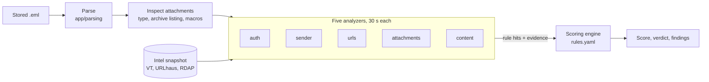

# How scoring works

Every verdict is a sum of rule points, and every point can be traced to evidence. There is
no machine learning and no hidden weighting: an analyst (or a reporter reading the reply)
can see exactly why an email was rated the way it was.

## Pipeline



1. **Parse** the original email (see the README for how originals are found).
2. **Inspect** attachments statically: libmagic type, ZIP listing (never extraction),
   VBA macros with `oletools`.
3. **Analyze**: five analyzers (`app/analyzers/`) are pure functions of the email, the
   policy (`config/settings.yaml`) and a read-only threat-intelligence snapshot. Each runs
   in its own thread with a 30-second limit; one that fails or overruns is reported as a
   partial analysis and the others still count.
4. **Score**: the engine (`app/scoring/engine.py`) looks up each hit in
   `app/scoring/rules.yaml`, adds the points and maps the total to a verdict.

## Verdicts

| Verdict | Condition |
| --- | --- |
| Malicious | total ≥ 70, or any `*_INTEL_MALICIOUS` rule |
| Suspicious | 40–69 |
| Low risk | 15–39 |
| No issues found | < 15 |

Nothing is ever called "safe": the best an automatic check can say is that it found no
issues. Analysts can re-classify; the original score is kept.

## Rules

Initial points from the project plan. How they are measured and tuned: [evaluation.md](evaluation.md).

| Rule ID | Analyzer | Points | Meaning |
| --- | --- | --- | --- |
| `AUTH_DMARC_FAIL` | auth | 30 | DMARC failed in a trusted Authentication-Results header. |
| `AUTH_SPF_FAIL` | auth | 10 (softfail 5) | SPF failed (softfail counts less). |
| `AUTH_DKIM_FAIL` | auth | 10 | DKIM signature failed and no other signature passed. |
| `AUTH_NO_TRUSTED_RESULTS` | auth | 0 | No authentication results from our own mail server (information only). |
| `SENDER_LOOKALIKE_DOMAIN` | sender | 30 | The sender's domain imitates one of our domains. |
| `SENDER_DISPLAY_NAME_SPOOF` | sender | 20 | The display name claims to be us, but the address is external. |
| `SENDER_FREEMAIL_IMPERSONATION` | sender | 15 | Claims to be an internal department but writes from free webmail. |
| `SENDER_NEW_DOMAIN` | sender | 15 | The sender's domain was registered less than 30 days ago. |
| `SENDER_REPLY_TO_MISMATCH` | sender | 10 | Replies go to a different domain than the sender's. |
| `URL_INTEL_MALICIOUS` | urls | 50, forces Malicious | Threat intelligence knows a link as malicious. |
| `URL_CREDENTIAL_FORM` | urls | 25 | The email itself contains a form or a password field. |
| `URL_TEXT_HREF_MISMATCH` | urls | 20 | A link shows one address but goes to another domain. |
| `URL_IP_HOST` | urls | 15 | A link points to a bare IP address. |
| `URL_PUNYCODE` | urls | 10 | A link host uses punycode (xn--), often to hide look-alike letters. |
| `URL_SHORTENER` | urls | 5 | A link uses a URL shortener that hides the destination. |
| `ATT_INTEL_MALICIOUS` | attachments | 60, forces Malicious | Threat intelligence knows an attachment as malicious. |
| `ATT_EXECUTABLE` | attachments | 40 | An attachment (or a file inside an archive) is a program or shortcut. |
| `ATT_EXT_MISMATCH` | attachments | 30 | An attachment's name hides what it really is. |
| `ATT_MACRO` | attachments | 30 | An Office document contains VBA macros. |
| `ATT_HTML_FILE` | attachments | 20 | An HTML or SVG attachment, a common way to deliver a fake login page. |
| `ATT_ENCRYPTED_ARCHIVE` | attachments | 20 | A password-protected archive, which scanners cannot look into. |
| `CONTENT_CREDENTIAL_REQUEST` | content | 15 | The text asks for a password, verification code or similar. |
| `CONTENT_URGENCY` | content | 5 | Urgent or threatening language (counted once). |

Rule details that matter in practice:

- **Each rule counts once per email**, however many links or phrases match; all matches
  are kept as evidence (up to ten).
- **Authentication** results are read only from headers whose authserv-id is in
  `trusted_authserv_ids`. Anyone can add `Authentication-Results: ... dmarc=pass` to a
  message they send; such headers are ignored and listed as evidence of
  `AUTH_NO_TRUSTED_RESULTS`.
- **Look-alike domains**: edit distance 1–2 to a protected domain, or 1–2 between the
  names before the suffix when the protected name has at least five letters
  (`examp1e.example` vs `example.edu`), or the same *skeleton* after folding homoglyphs
  (Cyrillic `а` to `a`, `rn` to `m`, `1` to `l`), or a label that mixes Latin with
  another alphabet. The same name under another TLD (`example.com`) is not a look-alike.
- **Inline forwards** keep only the body: authentication and sender rules are skipped,
  because the headers belong to the reporter.
- **Attachments** are judged from their bytes and names only. Executables inside a ZIP
  count; nested archives are not opened. Encryption is detected for ZIP files; RAR and
  7z are not listed.
- **Content** rules are English and Chinese keyword patterns within one sentence; a
  preceding "never" / "不会" (as in "we will never ask for your password") cancels a
  match.

## Evidence

Every finding stores a list of `{field, value, match}` items: the field that was examined
(`From`, `Authentication-Results`, `Attachment`, `HTML link`...), its value and what
matched. Indicator values in evidence are **defanged** (`hxxps://login[.]evil[.]example`),
because evidence is for display; the raw values are in the IOC table and exports.

```json
{
  "rule_id": "ATT_EXT_MISMATCH",
  "score": 30,
  "evidence": [
    {"field": "Attachment", "value": "invoice.pdf.exe", "match": "double extension .pdf.exe"}
  ]
}
```

## Tuning

Points and thresholds live in `app/scoring/rules.yaml`. To tune a running deployment
without rebuilding the image, copy the file to `config/rules.yaml` (mounted read-only into
the containers) and set `RULES_FILE=/app/config/rules.yaml`. The engine refuses unknown
keys, unknown analyzers, negative points and thresholds that are out of order, so a typo
is a startup error rather than a silent change. Rule IDs are fixed: they appear in
findings, exports and the audit log.

Try it: `uv run python -m app.cli analyze tests/fixtures/emails/01_credential_phish_qp.eml`
prints the verdict, every finding with its points, and the evidence.
