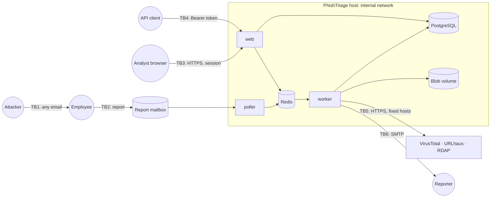

# Threat model

PhishTriage exists to handle email that attackers wrote. This page lists what it
protects, where the trust boundaries are, the threats against each (STRIDE) and the
control that answers each threat, with the code and the test that show it. The last
section checks the plan's security requirements one by one.

## Assets

| Asset | Why it matters |
| --- | --- |
| Reported emails and attachments | Content of employees' mailboxes: personal data, sometimes confidential documents. Attachments may be live malware. |
| Verdicts, evidence, analyst decisions | Wrong or tampered verdicts make employees trust phishing, or block legitimate mail. |
| Analyst accounts and sessions | Full read access to every report and the exports. |
| The audit log | Accountability for downloads, exports and verdict changes. |
| The reply channel | Mail from the organisation's own security address is trusted by employees: a perfect phishing vehicle if abused. |
| Secrets: `SECRET_KEY`, `API_TOKEN`, IMAP and SMTP passwords, VirusTotal and URLhaus keys | Session/CSRF forgery, API access, mailbox access, provider quota. |
| The server's network position | A server that fetches URLs from emails can be steered at internal services (SSRF) and reveals its IP to attackers. |

## Trust boundaries

* **TB1/TB2:** everything inside a reported email is attacker-controlled, including
  headers that look like they come from our own servers. The `From` of the report itself
  is only text too.
* **TB3/TB4:** the console and the API face the network; the API is off unless
  `API_TOKEN` is set.
* **TB5/TB6:** the only outbound connections: three intel providers and the SMTP server.
* **Internal:** PostgreSQL, Redis and the blob volume are reachable only from the
  application containers (no published ports). Anyone with write access to them is
  inside the trust boundary; the design still limits what such access buys (JSON jobs,
  validated blob paths).
* **Supply chain:** Python dependencies, container images and CI actions.

## Threats and controls (STRIDE)

### Spoofing

| # | Threat | Control | Evidence |
| --- | --- | --- | --- |
| S1 | A phishing email carries a forged `Authentication-Results: ... dmarc=pass` to look legitimate. | Only headers whose authserv-id is in `policy.trusted_authserv_ids` count, and only the topmost of them; the others are listed as ignored evidence. | `app/analyzers/auth.py`; sample `14_forged_auth_results` must stay suspicious (`test_verdicts.py`) |
| S2 | An outsider sends a "report" with `From: dean@example.edu` to make PhishTriage email the dean (reflector, or a lure from our own security address). | Replies only to `org_domains` and only when our MX recorded `dmarc=pass` for the reporter; one reply per submission; 20 per reporter and hour; the reply has no links and only a defanged subject. | `app/notify/reply.py`; `test_reply.py`, `tests/integration/test_mail_flow.py::test_external_reporter_gets_no_reply` |
| S3 | Password guessing or spraying against the console. | argon2id; 5 failures lock an account for 15 minutes, 30 failures lock the address; one generic error message; same timing for unknown accounts. | `app/web/auth.py`; `test_five_failures_lock_the_account`, `test_throttle_locks_account_and_address`, `test_login_failure_is_generic` |
| S4 | Session fixation or theft. | Random 256-bit tokens in Redis (stored as SHA-256), rotated on login and logout; `HttpOnly`, `SameSite=Lax`, `Secure` with the `__Host-` prefix; idle 60 min, absolute 12 h. | `test_login_success_rotates_the_token`, `test_logout_ends_the_session`, `test_session_store_timeouts` |
| S5 | Cross-site request forgery against verdicts, notes, uploads. | Every POST needs `HMAC(SECRET_KEY, cookie token)` and a same-origin `Origin`. | `test_post_without_csrf_token_is_403`, `test_csrf_token_of_another_browser_is_refused`, `test_csrf_header_and_origin` |
| S6 | A guessed or leaked API token. | API disabled without a token; token at least 32 characters, compared in constant time. | `test_api_disabled_without_token`, `test_api_requires_the_token` |

### Tampering

| # | Threat | Control | Evidence |
| --- | --- | --- | --- |
| T1 | A file name like `../../etc/cron.d/x` writes outside the store. | Blobs are named by SHA-256; file names are only displayed, with control characters removed. Paths read from the database must match the blob pattern. | `app/storage.py`; `test_resolve_refuses_foreign_paths`, `test_filename_control_characters_are_removed` |
| T2 | Write access to Redis turned into code execution through pickled jobs. | Jobs are JSON and carry only a report ID. | `app/queueing.py`; `test_worker_listens_on_reports_queue_with_json` |
| T3 | Intel answers poisoned in the cache. | Cache keys are SHA-256 of the indicator; only `hit`/`clean`/`not_found` are cached, with TTLs; Redis is internal. | `app/intel/cache.py` |
| T4 | A changed verdict without trace. | The automatic score and verdict are never overwritten; analyst verdicts and notes are append-only audit entries. | `test_reclassify_keeps_the_score`, `test_notes` |
| T5 | A forged "all pass" header or a lookalike domain lowers the score. | Untrusted headers never subtract points; there are no negative rules. | `app/scoring/rules.yaml`, `docs/scoring.md` |

### Repudiation

| # | Threat | Control | Evidence |
| --- | --- | --- | --- |
| R1 | An analyst denies downloading malware or exporting IOCs. | Audit entries for login (success, failure, lock), logout, upload, verdict, note, re-analysis, download, export and retention purge, with user, report and details. | `app/audit.py`; `test_attachment_download_is_an_encrypted_zip`, `test_exports.py`, `test_retention.py` |

### Information disclosure

| # | Threat | Control | Evidence |
| --- | --- | --- | --- |
| I1 | Opening a report loads a tracking pixel and tells the attacker the mail was read, from where. | The original HTML is never rendered. `nh3` allow-list without any URL attribute, shown in `<iframe sandbox>` with `default-src 'none'`. The server never fetches anything from an email. | `app/parsing/html.py`; `test_sanitize_drops_everything_active` |
| I2 | Attachments uploaded to VirusTotal become visible to every VT subscriber. | The VT client has no upload or scan method; files are looked up by hash, URLs by identifier (GET). | `test_vt_has_no_upload_or_scan_method`, `test_vt_url_lookup_is_a_get_by_identifier` |
| I3 | SSRF: an email makes the server request an internal URL. | No code path fetches email URLs. The intel HTTP client only reaches allow-listed HTTPS hosts and follows no redirects; RDAP servers come from a reviewed bundled list. | `app/intel/http.py`; `test_only_allowlisted_https_hosts`, `test_redirects_are_not_followed` |
| I4 | Secrets leak through the repository or logs. | Secrets only from environment variables (`SecretStr`); the policy file rejects unknown keys; gitleaks in pre-commit and CI; error messages store only exception types. | `app/config.py`; CI `secrets` job |
| I5 | Raw mail kept forever. | Raw messages, attachments and bodies deleted after 90 days; verdicts and IOCs kept. | `app/retention.py`; `test_retention.py` |
| I6 | Exports leak personal data. | CSV and STIX contain indicators, verdicts and dates, not subjects or reporter addresses. | `app/export/` |
| I7 | Error pages reveal internals. | `/readyz` hides error details; API docs only in development. | `test_docs_only_in_dev` |

### Denial of service

| # | Threat | Control | Evidence |
| --- | --- | --- | --- |
| D1 | Huge or deeply nested messages, zip bombs. | 25 MB, 20 attachments, 10 MIME levels; archives are listed, never extracted; the macro scan skips documents with a member over 25 MB; request bodies capped in middleware. | `test_rejects_oversize_message`, `test_rejects_deep_nesting`, `test_zip_listing_never_extracts`, `test_middleware_limit_applies_to_every_route` |
| D2 | An input that hangs an analyzer. | 30 s per analyzer with a shared deadline; a failing analyzer gives a "partial analysis", not a crash; RQ job timeout 600 s and 3 retries. | `test_slow_and_broken_analyzers_are_contained` |
| D3 | Report flooding exhausts the VirusTotal quota. | Token bucket (4/min) shared by all workers, daily budget 500, per-report caps; over budget, lookups are skipped, not queued forever. | `test_intel_service.py` |
| D4 | One oversized message blocks the mailbox. | It is moved to `Rejected` without being downloaded. | `test_imap_poller.py` |
| D5 | Mangled input crashes the parser. | A mutation test feeds damaged copies of every sample; any message is either parsed with recorded defects or rejected with a reason. | `test_parsing_robustness.py` |

### Elevation of privilege

| # | Threat | Control | Evidence |
| --- | --- | --- | --- |
| E1 | XSS from subject, display name, file name or body. | Jinja2 autoescaping; no `|safe` on email data; CSP without inline script; the HTML body only in a sandboxed frame. | `test_hostile_content_is_escaped`, `test_report_page_escapes_hostile_content`, `test_security_headers` |
| E2 | An analyst reads the audit log or acts as admin. | `require_admin` on the audit page. | `test_audit_page_is_for_administrators` |
| E3 | A malicious attachment runs on the server or an analyst's machine. | Attachments are never executed; downloads only as a ZIP encrypted with `infected`, named after the SHA-256. | `test_attachment_download_is_an_encrypted_zip` |
| E4 | Container escape or lateral movement after a parser exploit. | Non-root UID 10001, read-only root filesystem, `cap_drop: ALL`, `no-new-privileges`, no published database or Redis ports; the worker has no listening socket. | `docker-compose.yml`, `Dockerfile` |
| E5 | A compromised dependency or image. | `uv.lock` with hashes; pip-audit and a Trivy image scan in CI; images and actions pinned to exact versions; Dependabot. | CI `audit` and `image-scan` jobs |

## Residual risks and assumptions

* **The MX must strip forged `Authentication-Results`** carrying our own authserv-id
  (RFC 8601, section 5). If it does not, S1 and S2 weaken: a forged header placed above
  ours could pass for ours. Check this before enabling replies on a real mailbox.
* **Static analysis only.** No sandbox: a new phishing kit on a fresh domain with no
  intel hits and no tell-tale text can score low. Replies never say "safe", and
  analysts see every report.
* **A compromised analyst account** can read every report and export IOCs; the audit log
  makes it visible, it does not prevent it. There is no 2FA yet.
* **Redis and PostgreSQL** sit on the Compose network without published ports and
  without TLS; PostgreSQL has a password, Redis none. On more than one host, add Redis
  authentication and TLS to both.
* **Unfixed OS CVEs:** Trivy fails the build on HIGH/CRITICAL vulnerabilities that have a
  fix; Debian CVEs without a fixed package are reported but cannot be patched until
  Debian ships one.
* **Retention race:** a byte-identical file re-reported in the instant the purge deletes
  it is lost (the content-addressed store had it once); the new report fails and can be
  submitted again.

## Self-check against the plan's security design

| Requirement (plan) | Status | Where |
| --- | --- | --- |
| Message ≤ 25 MB, ≤ 20 attachments, ≤ 10 MIME levels; reject and record why | Done | `app/parsing/eml.py`, D1 |
| Archives listed, never extracted | Done | `app/parsing/attachments.py`, D1 |
| 30 s per analyzer; one failure does not affect the others | Done | `app/analyzers/runner.py`, D2 |
| Attachments stored by SHA-256; original names for display only | Done | `app/storage.py`, T1 |
| Plain-text body by default | Done | `report.html` |
| HTML: `nh3` allow-list, external resources removed, sandboxed iframe, strict CSP | Done | I1, E1 |
| Links shown defanged, never clickable | Done | `app/parsing/defang.py` |
| All fields auto-escaped | Done | E1 |
| The server never visits URLs from emails | Done | I3 |
| Only fixed intel APIs, hosts in code | Done | `app/intel/http.py`, I3 |
| Hash lookups only, nothing uploaded; URLs looked up, never submitted | Done | I2 |
| VirusTotal: token bucket, daily budget, README note on the licence | Done | D3, README |
| URLhaus Auth-Key | Done | `URLHAUS_AUTH_KEY`, `docs/intel.md` |
| Reply only to `org_domains` with a DMARC pass | Done | S2 |
| At most 20 replies per reporter and hour | Done | S2 |
| argon2 passwords; HttpOnly, Secure, SameSite=Lax cookies (Secure off only for the local demo); CSRF on every form | Done | S3, S4, S5 |
| Lock after 5 failed logins in 15 minutes for 15 minutes | Done | S3 |
| Audit log for verdict changes, exports, downloads, logins | Done | R1 |
| Attachment downloads as `infected` ZIP | Done | E3 |
| Secrets only from the environment; only `.env.example` committed | Done | I4 |
| Non-root containers, slim base image | Done | E4 |
| Raw emails and attachments deleted after 90 days (configurable); metadata and IOCs kept | Done | I5 |
| `docs/threat-model.md` with STRIDE | This page | |
| pip-audit and Trivy | Done: pip-audit finds no known vulnerabilities in the locked set; Trivy finds no HIGH or CRITICAL vulnerability with a fix in the image (2026-11-24) | CI `audit`, `image-scan` |
